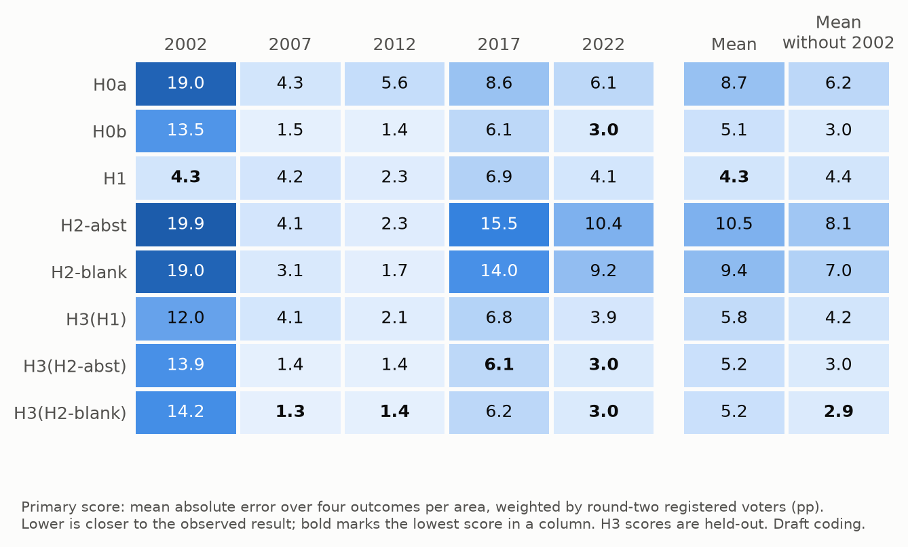
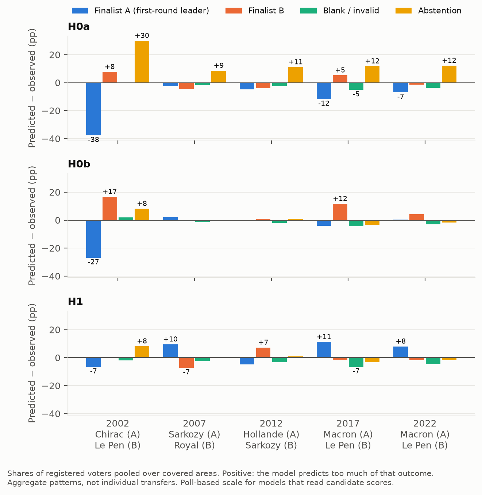
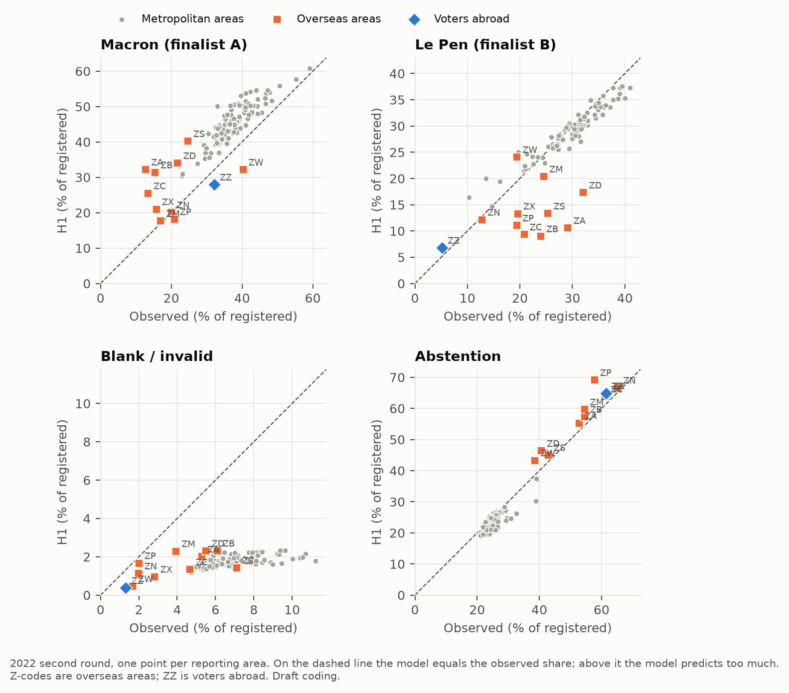

<!-- Generated from docs/templates/report.md by `vote-transfer analyse`. Edit the template, not this file. -->

# Which assumptions about voter behaviour best explain second-round results in French presidential elections (2002–2022)?

Victor Henz, Edgar Gusching, Louis Bettelli, Lucas Magret Delord, Oscar Moulet ·
Data, Data Storage, Data Collection · final report, draft of the analysis branch

> **Status: poll-based scale.** H1, H2 and H3 place candidates with the left-to-right
> orders published by polling institutes. The earlier hand-coded 1–7 scale is kept as
> a comparison (draft coding).

## 1. Question

Between the two rounds of a French presidential election, the supporters of
eliminated candidates must choose again: one of the two finalists, a blank or
invalid ballot, or abstention. We ask **which simple assumption about that choice
best reproduces the second-round result of each area from its first-round
result**, over the 5 elections from 2002 to 2022.

One observation is one reporting area (département, overseas area or voters
abroad) in one election: 522 observations. Every share is a share of
**registered voters**, so abstention and blank/invalid ballots are outcomes, not
missing data. We compare aggregate patterns. Individual ballots are secret, so
no result here says how any person voted. An inconclusive answer is possible, and
section 6 argues that it is the honest one.

## 2. Data and acquisition

**Source.** The Ministry of the Interior's polling-station result files for both
rounds of each election, published on data.gouv.fr: 293 MB of
text, 673,228 station-round records. We chose the original
station files over ready-made consolidated tables so that every aggregation step
is ours and checkable.

**Procedure.** `vote-transfer acquire` queries the data.gouv.fr API, selects a
pinned resource identifier per election and round, and records the URL, retrieval
time, size and SHA-256 hash in a versioned manifest. Any later download must
reproduce the hash, and processing refuses different bytes.

**Second source, collected by us.** H1–H3 need a left–right position for each of
the 61 first-round candidacies. Polling institutes list the
candidates in a left-to-right order in their published reports, and these orders
cover every candidate, minor ones included. We extracted the order of
22 polls by 9 institutes: the last pre-election poll
we could find per institute (1 for 2002, 3 for
2007, 3 for 2012), and the 7 and
8 orders for 2017 and 2022 compiled by Delemazure, Dong, Peters
and Tydrichová (2024). `data/reference/polling_axes.csv` records the institute,
fieldwork dates, client and source link of each. `notebooks/candidate_scale.ipynb`
turns them into a score from 0 (leftmost) to 1 (rightmost): within each poll the
candidates are evenly spaced, then each candidate's positions are averaged across
institutes. This follows the advice of Magdaléna Tydrichová, and replaced both the
planned Chapel Hill Expert Survey table (it rates parties, not candidacies, and
misses most minor candidates) and our first hand-coded 1–7 scale, which no outside
source checked.

**Bias and coverage.** Within registered voters the results are a census: no
sampling error. The limits are elsewhere. (i) People who are not registered are
outside the frame. (ii) The 2002 and 2007 files omit voters abroad and some
overseas areas (100 and 101 areas against 107 from
2012), so their totals are not national totals. (iii) The candidate scale is an
order, not a measured distance, and rests on 1 institute for 2002;
section 7 returns to it. The files contain no personal data.

## 3. Cleaning

Official totals leave little to clean and much to verify. The threshold for every
rule is zero violations, and a violation stops the pipeline instead of being
repaired, because with official counts it can only mean that we parsed a file
wrongly. Checks cover schema per file layout (three layouts over twenty years),
unique station and candidate keys, bounds (`voters ≤ registered`,
`valid ≤ voters`), candidate votes equal to valid ballots in every station, and
identical areas in both rounds. Our 2022 sums match the Ministry's published national summaries on all 26 fields compared (`vote-transfer crosscheck`, rerun on 15 November 2026).

We removed, imputed and corrected no observation. Three decisions matter for the
analysis:

- **Derived fields.** Before 2017 only registered voters, voters and valid
  ballots are published; abstention and blank/invalid are derived by exact
  identities and recorded as derived.
- **Blank and invalid ballots.** Before 2017 they are published together. We use
  the combined outcome in every election so the outcome has one definition, and
  keep the separate counts for 2017 and 2022 (null earlier, never zero) for a
  sensitivity analysis.
- **Unusual areas are flagged, not removed.** Overseas areas and voters abroad
  have very different turnout. They are part of the electorate we study.

The poll-based scale has its own checks. Completeness: every candidacy appears in
every poll of its election, and every candidate identifier matches the Ministry
files. Consistency: a candidate is **unplaced** if institutes disagree by more than
0.4 on their position, or if institutes list them last by default (Jacques
Cheminade). 3 candidacies are unplaced (Cheminade 2012, Cheminade 2017, Lassalle 2017);
they are removed from their election's polls, the others are spread again between 0
and 1, and their voters follow the H0b row. After that, the largest disagreement for
a placed candidate is 0.36. Both rules were fixed before
any model was run on the scale. Accuracy: 7 orders come from
the institutes' reports and 15 from the published compilation;
each is checked against its source.

## 4. Storage

Raw text is kept unchanged. Cleaned data is stored as **Parquet files in a
normalised layout**: per election an `areas` table (denominator, number of
stations, blank and invalid counts), an `outcomes` table (one count per option)
and an `options` table (labels); and one long `predictions` table for every
model, variant and election. Shares are computed, never stored; the wide table
the app needs is a view built on load. This layout answers the second peer
review, which found a repeated denominator and one result file per model.

We compared this in detail with a relational database (SQLite or PostgreSQL) and
with DuckDB over the same files (`docs/storage_comparison.md`). Our operations
are: write once by one process, read whole columns, join across models and
elections, and be reproduced exactly by a reader with no setup. A database would
add what we lack, **declarative keys and constraints**; we verified that our
tables load into SQLite with primary keys, foreign keys and checks. It would cost
what we value most: files that rebuild byte for byte, can be hashed, and are
small enough to version (629 kB in all, against
11583 kB as CSV). PostgreSQL would also add a server for
every reader. DuckDB is not a different store but a query engine over our files;
it becomes useful if the predictions grow well beyond their
91,872 rows. **Limits of our choice:** constraints are
enforced by code on every write and load, not by the storage engine; joins live
in Python; and two copies of the snapshots can diverge, which a check detects.
The collected poll orders and the scale built from them stay CSV files: they are
small, edited or regenerated by hand, and reviewed line by line in Git, with their
types and rules enforced on load. The scale keeps every decimal: rounded to three
decimals, a candidate exactly halfway between the finalists (Christine Boutin in
2002) would no longer count as a tie.

## 5. Methodology

**Models.** Each assumption is a transfer matrix: one row per first-round group,
one column per outcome (finalist A, finalist B, blank/invalid, abstention), rows
summing to one. Both finalists' voters, first-round blank/invalid voters and
abstainers keep their position in every model; models differ only in where the
supporters of eliminated candidates go. The rules of H0a, H1 and H2 were fixed
before their results were computed. H0b was added after the second peer review,
that is after the original baseline's failure on abstention was known, so it is a
response to a result and not a pre-specified model. H1-soft was likewise added
after the first results, in response to a later review.

| Model | Eliminated supporters… | Fitted |
|---|---|---|
| H0a | split like the rest of the electorate, abstainers included | no |
| H0b | split between the two finalists and blank/invalid, in proportion to first-round shares; none abstain | no |
| H1 | go to the finalist nearest on the poll-based scale (a tie splits 50/50) | no |
| H1-soft | split between the two finalists, each getting a share inversely proportional to its distance (added after the other results were known) | no |
| H2-abst, H2-blank | as H1, unless at least one third of the scale from both finalists: then abstention, or a blank ballot | no |
| H3 | a share `p` splits as in H0b, the rest follows H1 or H2 | `p` |

Unplaced candidates use the H0b row. The H2 threshold of one third is the rule
written before any result, two steps out of six on the 1–7 scale, carried over
unchanged. We report both H2 variants and do not
choose between them by fit. We use simple, parameter-free rules first because the
question is about assumptions that can be stated in one sentence; H3 is the only
fitted model, with one parameter.

**Evaluation.** The primary score is, per area, the mean absolute error over the
four outcomes in percentage points (pp), averaged with round-two registered
voters as weights. Errors are taken before pooling, so opposite errors in two
areas cannot cancel. The signed error per outcome after pooling is a secondary
diagnostic.

**Validation of H3.** Leave-one-election-out: `p` is fitted by grid search (step
0.01) on four elections and scored on the fifth, for each election in turn. Areas
of one election are never split between training and test. Only held-out scores
are reported. With five elections this describes how a rule transfers; it
supports no significance claim.

## 6. Results



*Figure 1. Primary score (pp) per model and election; lower is closer to the
observed result. H3 is held-out.*

**Observations.**

1. **The original baseline fails on abstention.** H0a over-predicts abstention in
   5 of 5 elections, by
   8.6 to 30.0 pp (Figure 2). H0b,
   which removes that one channel, scores lower in 5 of
   5 elections (mean 5.1 against 8.7 pp).
2. **The lowest five-election mean is H1** (4.7 pp), ahead of
   H0b (5.1 pp). But H1 beats H0b in only
   2 of 5 elections, and most of its lead comes from
   2002, where it scores 4.4 pp against 13.5.
3. **Splitting by distance trades 2002 for the other elections.** H1-soft averages
   5.4 pp (rank 3) and 3.6 pp
   without 2002. It is closer than H1 outside 2002 (for example 2.3
   against 4.1 pp in 2012) but much worse in 2002 (12.6
   against 4.4): on an evenly spaced scale Chirac and Le Pen are almost as
   far from Jospin, so a large share of the left goes to Le Pen.
4. **Without 2002 the order changes** (a post-hoc check: we set 2002 aside after
   seeing that H1 beats H0b mainly there). H1 falls to rank
   8 of 9 (4.8 pp); H0b is at
   3.0 pp and the lowest mean is
   H0b (3.01 pp), followed
   by the H3 mixtures on the H2 bases (3.13 and
   3.16 pp), which are almost entirely H0b.
5. **The distance threshold fails in one election.** H2-abst and H2-blank have
   means of 7.6 and 7.2 pp and beat H0b in
   1 and 1 of 5 elections.
   The damage is in 2002: both finalists sit on the right of the scale
   (0.80 and 0.93), so the whole left
   is at least one third away from both and H2 sends 29.9% of
   registered voters to a non-vote; H2-abst then scores 19.4 pp.
   In the other elections the rule removes little (1.4% in 2007,
   0.4% in 2012, 1.3% in 2017 and
   2.6% in 2022), and H2 scores close to H1. So in practice the
   threshold is tested in one election only, and we do not claim that it helps.
6. **H3 adds little.** On the H2 bases the fitted `p` is between
   0.77 and 1.00: the fit almost discards the H2
   rule. On H1, `p` is between 0.15 and 0.34 in four folds and
   0.83 when 2002 is held out. Held-out H3(H1) is worse than H1 over five
   elections (5.6 against 4.7 pp) but better without
   2002 (4.1 against 4.8 pp).
7. **Blank and invalid ballots are under-predicted** in 2017 and 2022 by every
   model, H2-blank included (-5.2 and
   -2.0 pp).
   Invalid ballots are 26% of the category
   in 2017 and 26% in 2022; their error is the
   same for every model (-1.6 and
   -1.1 pp).



*Figure 2. Predicted minus observed share of registered voters, pooled over
covered areas, for both baselines and H1.*

**Sensitivity.** We rerun every model with the hand-coded 1–7 scale (put on 0–1,
so the threshold is unchanged) and with its alternative families. With the 1–7
scale, H1 still has the lowest mean (H1 moves by
-0.39 pp) and H0b still ranks
2, but H2 is much worse
(+2.9 pp for H2-abst): the hand-coded
scale put the left of 2017 and 2022 two steps from the centrist finalist, so H2
sent it to a non-vote. With the alternative families the lowest mean becomes
H3(H2-blank). The conclusion that matters holds on both scales:
H1 leads over five elections because of 2002, and without 2002 the lead goes to H0b
or to an H3 mixture that is almost H0b
(H3(H2-blank) on the 1–7 scale). The tie rule
matters little: 2 candidates are exactly halfway between the
finalists on the poll-based scale (2002, 2007), and sending them to
abstention instead of splitting them moves no mean by more than
0.10 pp. With blank ballots scored alone, the order of models
is unchanged in 2017 and is unchanged in 2022.



*Figure 3. H1 against observed shares by area, 2022. Overseas areas
(Z-codes) and voters abroad (ZZ) are highlighted.*

In 2022, H1 scores 4.3 pp in metropolitan
areas and 8.1 pp overseas, where H0b scores
3.3 pp.

**Interpretation.** These readings go beyond the numbers and carry the caveats of
section 7. First, most of the original baseline's error came from one modelling
choice, not from voters behaving unpredictably; the baseline to beat is H0b.
Second, **we cannot name one best assumption.** Ideological proximity describes
2002 far better than anything else, plausibly because that runoff opposed the
right and the far right and almost every other voter ended on the same side. In
the four other elections, "people who voted once vote again, in proportion to the
finalists' first-round strength" does as well or better. Five elections cannot
separate a general rule from one exceptional election. Third, H2's failure is
concentrated in 2002, the one runoff between the right and the far right: a
"too far from both, so stay home" rule predicts that the left abstains, while it
voted for Chirac. How much H2 fails also depends on where the candidates are
placed, since a threshold decides between all and none. The threshold was fixed before any result was seen and we add no
other, since choosing one now would be tuning on the evaluation elections. Fourth, a left–right scale built from national polls may
describe overseas electorates poorly; this is a hypothesis.

## 7. Limitations

- **Aggregate inference.** Many different individual behaviours give the same
  area totals. A matrix that fits is not an observed transfer.
- **An order, not a distance.** Within a poll, neighbouring candidates are
  always the same distance apart, whatever their real ideological gap. Institutes'
  table conventions also enter the scale: in 2007 they list the PS before the
  Greens, so Dominique Voynet sits slightly right of Ségolène Royal.
- **Few sources for 2002.** We found the original report of 1
  institute only; 15 of the 22 orders come from a
  published compilation, not the institutes' own reports.
- **Comparison scale.** The hand-coded 1–7 scale used as a comparison is a draft
  that two coders did not review (59 draft rows).
- **One dimension.** The scale ignores other dimensions (Europe, sovereignty,
  ecology).
- **Coverage.** 2002 and 2007 describe covered areas only; years are not
  identical geographic samples.
- **Combined blank/invalid.** The primary outcome mixes a deliberate act with
  mistakes; the separate analysis exists for two elections only.
- **Retained groups never move.** In every model, finalists' voters and first-round
  blank and abstaining voters keep their position, and errors are shares of
  registered voters averaged over four outcomes. Any real movement of retained
  groups is an error floor shared by all models, which compresses the differences
  between them; scores are not comparable with studies that use valid votes.
- **Few elections and model selection.** Eight models compared on five elections:
  the "best" is partly a selection effect. We dropped the planned H4 and H5 and
  two-dimensional distances, which needed data we could not justify.

## 8. Reproducibility and response to feedback

```bash
uv sync --locked --dev      # environment from the lock file
make data                   # acquire, process, scale, evaluate, bundle (all five elections)
make analysis               # the candidate scale, every model result, figure, table and number
make check                  # tests, lint, and processed-versus-bundled comparison
```

A clone already contains verified snapshots, so `make analysis` and the app run
offline. Every number in this report is read from `reports/results/numbers.json`;
the report is rendered from a template, so it cannot drift from the results. Raw
files are pinned by hash. What a command cannot reproduce is the extraction of the
poll orders from the institutes' reports, which is why each row of
`polling_axes.csv` links to its source; a test fails if the scale is not rebuilt
after the polls change.

**What changed after peer feedback** (`docs/response_to_reviews.md` lists every
comment). After the first review we dropped H4, H5 and all auxiliary datasets.
After the second we (i) added the second baseline H0b, which turned out to matter
more than any other change; (ii) replaced the unreviewed hand-coded candidate
table with positions built from polling institutes, as the reviewers' concern about
its accuracy and Magdaléna Tydrichová's advice suggested, and assessed it; (iii) normalised the storage and
moved to one predictions table; (iv) kept blank and invalid counts separately;
(v) fixed the reproduction commands; and (vi) produced the cross-election
figures the reviewers asked for.

AI assistance was used for code, tests and drafting. The team owns the
methodological decisions and the interpretation.
