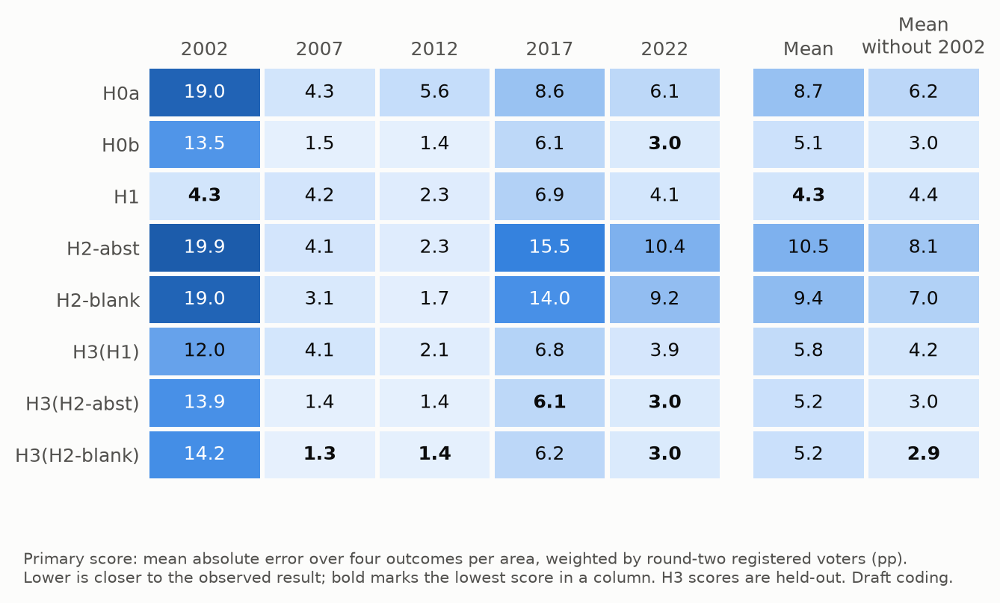
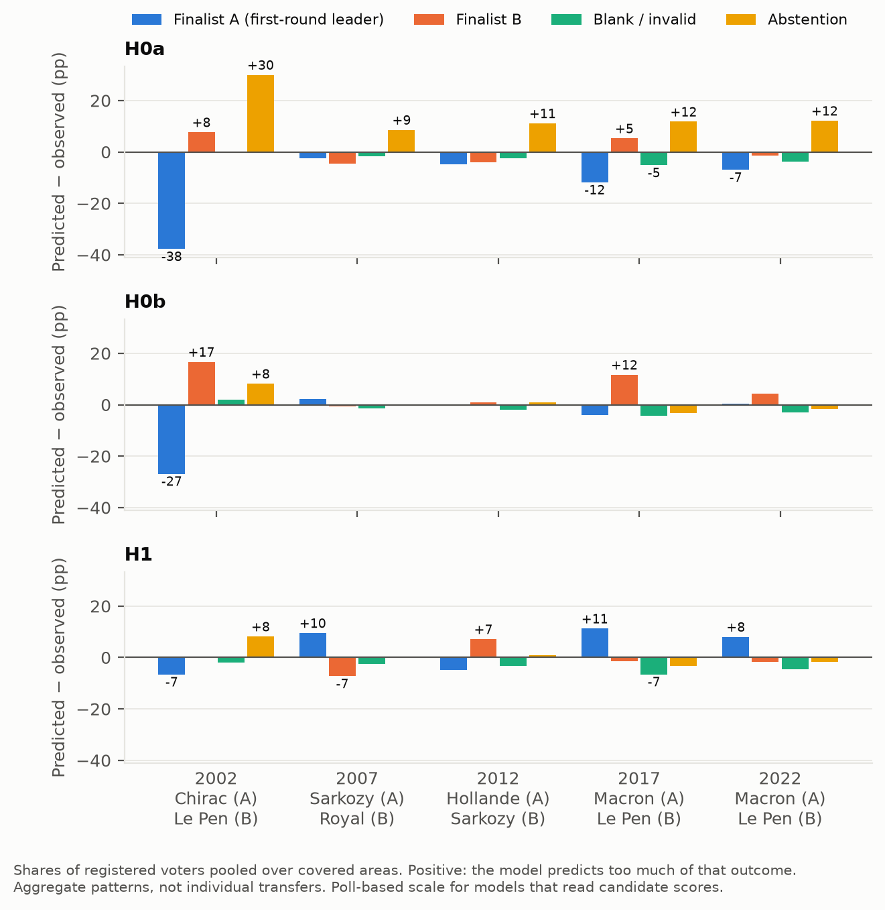

# Which assumptions about voter behaviour best explain second-round results in French presidential elections (2002–2022)?

Victor Henz, Edgar Gusching, Louis Bettelli, Lucas Magret Delord, Oscar Moulet ·
Data, Data Storage, Data Collection · final report, draft of the analysis branch

> **Status: {{coding_status}}.** Results for H1, H2 and H3 use candidate positions
> that have not yet been reviewed by two coders. `[PENDING: coder agreement]`

## 1. Question

Between the two rounds of a French presidential election, the supporters of
eliminated candidates must choose again: one of the two finalists, a blank or
invalid ballot, or abstention. We ask **which simple assumption about that choice
best reproduces the second-round result of each area from its first-round
result**, over the {{n.elections}} elections from 2002 to 2022.

One observation is one reporting area (département, overseas area or voters
abroad) in one election: {{areas.total}} observations. Every share is a share of
**registered voters**, so abstention and blank/invalid ballots are outcomes, not
missing data. We compare aggregate patterns. Individual ballots are secret, so
no result here says how any person voted. An inconclusive answer is possible, and
section 6 argues that it is the honest one.

## 2. Data and acquisition

**Source.** The Ministry of the Interior's polling-station result files for both
rounds of each election, published on data.gouv.fr: {{storage.raw_mb|.0f}} MB of
text, {{storage.station_rows|,}} station-round records. We chose the original
station files over ready-made consolidated tables so that every aggregation step
is ours and checkable.

**Procedure.** `vote-transfer acquire` queries the data.gouv.fr API, selects a
pinned resource identifier per election and round, and records the URL, retrieval
time, size and SHA-256 hash in a versioned manifest. Any later download must
reproduce the hash, and processing refuses different bytes.

**Second source, made by us.** H1–H3 need a political position for each of the
{{n.candidacies}} first-round candidacies. We coded each on a seven-family
left–right scale (1 Far left to 7 Far right), with sources and a plausible
alternative family for {{quality.with_alternative}} of them. This replaced the
planned Chapel Hill Expert Survey table, which rates parties, not candidacies.

**Bias and coverage.** Within registered voters the results are a census: no
sampling error. The limits are elsewhere. (i) People who are not registered are
outside the frame. (ii) The 2002 and 2007 files omit voters abroad and some
overseas areas ({{areas.2002}} and {{areas.2007}} areas against {{areas.2022}} from
2012), so their totals are not national totals. (iii) The candidate scale is our
own judgement, not a measurement; it is the weakest input and section 7 returns
to it. The files contain no personal data.

## 3. Cleaning

Official totals leave little to clean and much to verify. The threshold for every
rule is zero violations, and a violation stops the pipeline instead of being
repaired, because with official counts it can only mean that we parsed a file
wrongly. Checks cover schema per file layout (three layouts over twenty years),
unique station and candidate keys, bounds (`voters ≤ registered`,
`valid ≤ voters`), candidate votes equal to valid ballots in every station, and
identical areas in both rounds. {{text.crosscheck}}

We removed, imputed and corrected no observation. Three decisions matter for the
analysis:

- **Derived fields.** Before 2017 only registered voters, voters and valid
  ballots are published; abstention and blank/invalid are derived by exact
  identities and recorded as derived.
- **Blank and invalid ballots.** Before 2017 they are published together. We use
  the combined outcome in every election so the outcome has one definition, and
  keep the separate counts for 2017 and 2022 (null earlier, never zero) for a
  sensitivity analysis.
- **Unusual areas are flagged, not removed.** Overseas areas and voters abroad
  have very different turnout. They are part of the electorate we study.

The candidate table is assessed with the same characteristics. Consistency: of
{{quality.parties_checked}} party labels, {{quality.inconsistent_parties}} are coded
with more than one family across elections (both documented choices awaiting
review). Completeness: {{quality.without_score}} rows have no score. Accuracy, the
agreement between two independent coders: `[PENDING: coder agreement]`. The full
assessment is in `docs/candidate_table_quality.md`.

## 4. Storage

Raw text is kept unchanged. Cleaned data is stored as **Parquet files in a
normalised layout**: per election an `areas` table (denominator, number of
stations, blank and invalid counts), an `outcomes` table (one count per option)
and an `options` table (labels); and one long `predictions` table for every
model, variant and election. Shares are computed, never stored; the wide table
the app needs is a view built on load. This layout answers the second peer
review, which found a repeated denominator and one result file per model.

We compared this in detail with a relational database (SQLite or PostgreSQL) and
with DuckDB over the same files (`docs/storage_comparison.md`). Our operations
are: write once by one process, read whole columns, join across models and
elections, and be reproduced exactly by a reader with no setup. A database would
add what we lack, **declarative keys and constraints**; we verified that our
tables load into SQLite with primary keys, foreign keys and checks. It would cost
what we value most: files that rebuild byte for byte, can be hashed, and are
small enough to version ({{storage.total_parquet_kb|.0f}} kB in all, against
{{storage.total_csv_kb|.0f}} kB as CSV). PostgreSQL would also add a server for
every reader. DuckDB is not a different store but a query engine over our files;
it becomes useful if the predictions grow well beyond their
{{storage.prediction_rows|,}} rows. **Limits of our choice:** constraints are
enforced by code on every write and load, not by the storage engine; joins live
in Python; and two copies of the snapshots can diverge, which a check detects.
The hand-edited candidate table stays a CSV, so that changes are reviewed line by
line in Git, with its types enforced on load.

## 5. Methodology

**Models.** Each assumption is a transfer matrix: one row per first-round group,
one column per outcome (finalist A, finalist B, blank/invalid, abstention), rows
summing to one. Both finalists' voters, first-round blank/invalid voters and
abstainers keep their position in every model; models differ only in where the
supporters of eliminated candidates go. The rules of H0a, H1 and H2 were fixed
before their results were computed. H0b was added after the second peer review,
that is after the original baseline's failure on abstention was known, so it is a
response to a result and not a pre-specified model.

| Model | Eliminated supporters… | Fitted |
|---|---|---|
| H0a | split like the rest of the electorate, abstainers included | no |
| H0b | split between the two finalists and blank/invalid, in proportion to first-round shares; none abstain | no |
| H1 | go to the finalist nearest on the 1–7 scale (a tie would split 50/50) | no |
| H2-abst, H2-blank | as H1, unless at least two steps from both finalists: then abstention, or a blank ballot | no |
| H3 `[PENDING: professor approval]` | a share `p` splits as in H0b, the rest follows H1 or H2 | `p` |

Candidates without a score use the H0b row. We report both H2 variants and do not
choose between them by fit. We use simple, parameter-free rules first because the
question is about assumptions that can be stated in one sentence; H3 is the only
fitted model, with one parameter.

**Evaluation.** The primary score is, per area, the mean absolute error over the
four outcomes in percentage points (pp), averaged with round-two registered
voters as weights. Errors are taken before pooling, so opposite errors in two
areas cannot cancel. The signed error per outcome after pooling is a secondary
diagnostic.

**Validation of H3.** Leave-one-election-out: `p` is fitted by grid search (step
0.01) on four elections and scored on the fifth, for each election in turn. Areas
of one election are never split between training and test. Only held-out scores
are reported. With five elections this describes how a rule transfers; it
supports no significance claim. H3 is included pending approval of its fitted
parameter. `[PENDING: professor approval]`

## 6. Results



*Figure 1. Primary score (pp) per model and election; lower is closer to the
observed result. H3 is held-out.*

**Observations.**

1. **The original baseline fails on abstention.** H0a over-predicts abstention in
   {{signed_positive_elections.H0a.abstention}} of {{n.elections}} elections, by
   {{signed_min.H0a.abstention}} to {{signed_max.H0a.abstention}} pp (Figure 2). H0b,
   which removes that one channel, scores lower in {{wins.H0b.vs_H0a}} of
   {{n.elections}} elections (mean {{score.H0b.mean}} against {{score.H0a.mean}} pp).
2. **The lowest five-election mean is {{best.model}}** ({{best.mean}} pp), ahead of
   H0b ({{score.H0b.mean}} pp). But {{best.model}} beats H0b in only
   {{wins.H1.vs_H0b}} of {{n.elections}} elections: 2002, where it scores
   {{score.H1.2002}} pp against {{score.H0b.2002}}.
3. **Without 2002 the order changes** (a post-hoc check: we set 2002 aside after
   seeing that {{best.model}} beats H0b only there). {{best.model}} falls to rank
   {{best.rank_without_2002}} of {{n.models}} ({{best.mean_without_2002}} pp); H0b is at
   {{score.H0b.mean_without_2002}} pp and the lowest mean is
   {{best_without_2002.model}} ({{best_without_2002.mean_without_2002|.2f}} pp), a
   mixture that is almost entirely H0b.
4. **The distance threshold makes things worse.** H2-abst and H2-blank have the
   highest means ({{score.H2-abst.mean}} and {{score.H2-blank.mean}} pp). They beat
   H0b in {{wins.H2-abst.vs_H0b}} and {{wins.H2-blank.vs_H0b}} of {{n.elections}} elections.
   In 2017 and 2022 the finalists are coded {{h2.2022.finalist_a_score}} and
   {{h2.2022.finalist_b_score}}, so every group coded {{h2.2022.on_threshold_scores}} is exactly {{h2.threshold}}
   steps from the nearer one and is sent to a non-vote:
   {{h2.2017.on_threshold_pct}}% and {{h2.2022.on_threshold_pct}}% of registered
   voters. In 2002 (finalists at {{h2.2002.finalist_a_score}} and
   {{h2.2002.finalist_b_score}}) the rule removes {{h2.2002.beyond_pct}}%; in 2007 and
   2012, {{h2.2007.beyond_pct}}% and {{h2.2012.beyond_pct}}%.
5. **H3 adds little** `[PENDING: professor approval]`**.** On the H2 bases the fitted `p` is between
   {{p.H2-blank.min|.2f}} and {{p.H2-abst.max|.2f}}: the fit discards the H2 rule. On
   H1, `p` is at most {{p.H1.2017|.2f}} in four folds and {{p.H1.2002|.2f}} when 2002
   is held out, and held-out H3(H1) is worse than H1 itself
   ({{score.H3(H1).mean}} against {{score.H1.mean}} pp).
6. **Blank and invalid ballots are under-predicted** in 2017 and 2022 by every
   model except H2-blank, which over-predicts them by
   {{signed.H2-blank.2017.blank_invalid}} and {{signed.H2-blank.2022.blank_invalid}} pp.
   Invalid ballots are {{blank.2017.invalid_share_of_combined|.0f}}% of the category
   in 2017 and {{blank.2022.invalid_share_of_combined|.0f}}% in 2022; their error is the
   same for every model ({{blank.2017.signed_invalid|+.1f}} and
   {{blank.2022.signed_invalid|+.1f}} pp).



*Figure 2. Predicted minus observed share of registered voters, pooled over
covered areas, for both baselines and {{best.model}}.*

**Sensitivity.** With the alternative coding the order of models
{{sens.alternative.split.text.same_ranking}}: the lowest mean becomes
{{sens.alternative.split.best.model}}, H1 moves by
{{sens.alternative.split.change.H1.mean|+.2f}} pp and H0b ranks
{{sens.alternative.split.rank.H0b}}. The tie rule has no effect: {{ties.primary.count}}
ties occur under the primary coding and {{ties.alternative.count}} under the
alternative. With blank ballots scored alone, the order of models
{{blank.2017.text.same_ranking}} in 2017 and {{blank.2022.text.same_ranking}} in 2022.


*Figure 3. {{best.model}} against observed shares by area, 2022. Overseas areas
(Z-codes) and voters abroad (ZZ) are highlighted.*

In 2022, {{best.model}} scores {{territory.metropolitan.H1.2022}} pp in metropolitan
areas and {{territory.overseas.H1.2022}} pp overseas, where H0b scores
{{territory.overseas.H0b.2022}} pp.

**Interpretation.** These readings go beyond the numbers and carry the caveats of
section 7. First, most of the original baseline's error came from one modelling
choice, not from voters behaving unpredictably; the baseline to beat is H0b.
Second, **we cannot name one best assumption.** Ideological proximity describes
2002 far better than anything else, plausibly because that runoff opposed the
right and the far right and almost every other voter ended on the same side. In
the four other elections, "people who voted once vote again, in proportion to the
finalists' first-round strength" does as well or better. Five elections cannot
separate a general rule from one exceptional election. Third, H2's failure is a
finding about thresholds on a coarse ordinal scale, not about voters: on seven
points, one step decides whether the whole left votes for the nearer finalist or
not at all. The threshold was fixed before any result was seen and we add no
other, since choosing one now would be tuning on the evaluation elections. Fourth, a left–right scale coded for national politics may
describe overseas electorates poorly; this is a hypothesis.

## 7. Limitations

- **Aggregate inference.** Many different individual behaviours give the same
  area totals. A matrix that fits is not an observed transfer.
- **Draft coding.** Every H1–H3 number rests on {{quality.draft_rows}} draft codes.
  The ranking changes under the alternative coding, so conclusions about H1
  relative to H0b are provisional. `[PENDING: coder agreement]`
- **One alternative coding.** It moves all {{quality.with_alternative}} listed rows at
  once, finalists included: a single alternative scenario, not a per-candidate
  sensitivity analysis.
- **One-dimensional, equally spaced scale.** Distances assume equal steps between
  families and ignore other dimensions (Europe, sovereignty, ecology).
- **Coverage.** 2002 and 2007 describe covered areas only; years are not
  identical geographic samples.
- **Combined blank/invalid.** The primary outcome mixes a deliberate act with
  mistakes; the separate analysis exists for two elections only.
- **Retained groups never move.** In every model, finalists' voters and first-round
  blank and abstaining voters keep their position, and errors are shares of
  registered voters averaged over four outcomes. Any real movement of retained
  groups is an error floor shared by all models, which compresses the differences
  between them; scores are not comparable with studies that use valid votes.
- **Few elections and model selection.** Eight models compared on five elections:
  the "best" is partly a selection effect. We dropped the planned H4 and H5 and
  two-dimensional distances, which needed data we could not justify.

## 8. A 2027 scenario, not a forecast

No 2027 first-round data exists and we collect no polls. The app's "2027
scenarios" page takes the **2022 first-round results by area** as the electorate,
lets the user name two 2022 candidates as stand-ins for the finalists, and
applies one assumption. The default is H0b, not {{best.model}}:
{{best.model}}'s lead comes from 2002 alone (rank {{best.rank_without_2002}} of
{{n.models}} without it), while H0b needs no candidate coding and ranks
{{rank.H0b}} with 2002 and {{rank_without_2002.H0b}} without. An option shows every
model side by side. Since the assumptions disagree and none is clearly best, the
spread between them is the message, not a prediction. Limits: finalists are
candidates, not political families, and there is no map (we hold no boundary
data).

## 9. Reproducibility and response to feedback

```bash
uv sync --locked --dev      # environment from the lock file
make data                   # acquire, process, evaluate, bundle (all five elections)
make analysis               # every model result, figure, table and this report's numbers
make check                  # tests, lint, and processed-versus-bundled comparison
```

A clone already contains verified snapshots, so `make analysis` and the app run
offline. Every number in this report is read from `reports/results/numbers.json`;
the report is rendered from a template, so it cannot drift from the results. Raw
files are pinned by hash. What cannot be reproduced by a command is the coding of
the candidate table, which is why two people code it independently and their
agreement is reported.

**What changed after peer feedback** (`docs/response_to_reviews.md` lists every
comment). After the first review we dropped H4, H5 and all auxiliary datasets.
After the second we (i) added the second baseline H0b, which turned out to matter
more than any other change; (ii) brought the candidate table into the quality
assessment and built the two-coder review; (iii) normalised the storage and
moved to one predictions table; (iv) kept blank and invalid counts separately;
(v) fixed the reproduction commands; and (vi) produced the cross-election
figures the reviewers asked for.

AI assistance was used for code, tests and drafting. The team owns the
methodological decisions and the interpretation.
